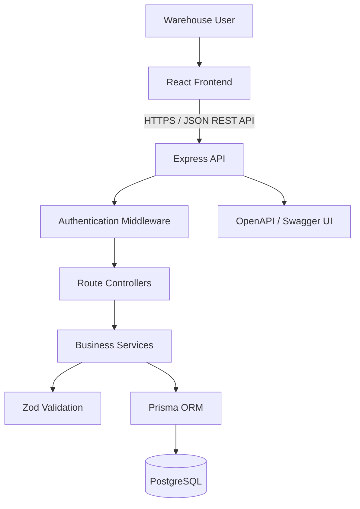
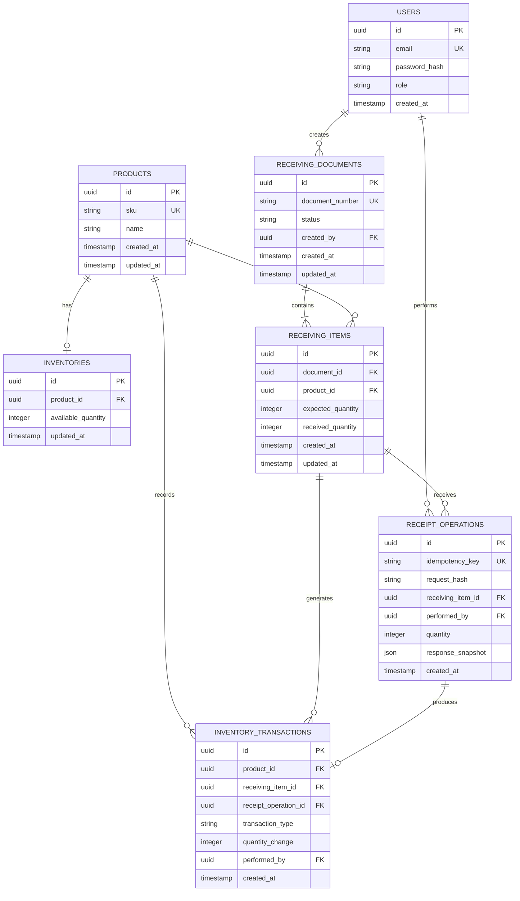
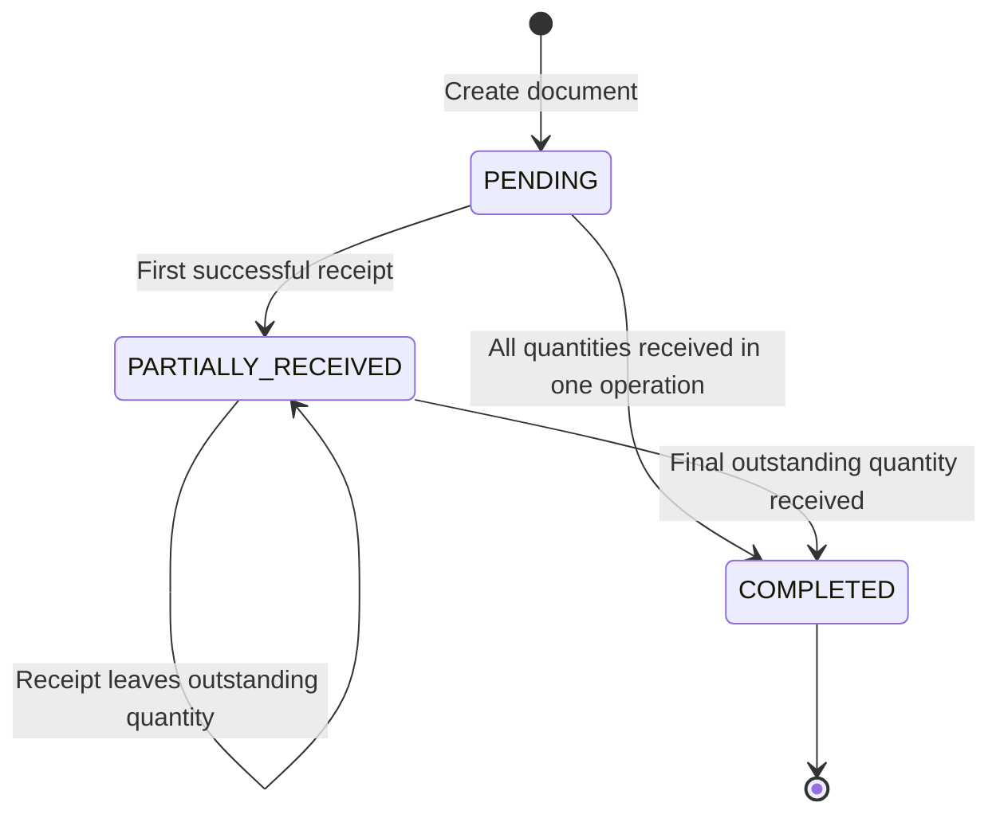
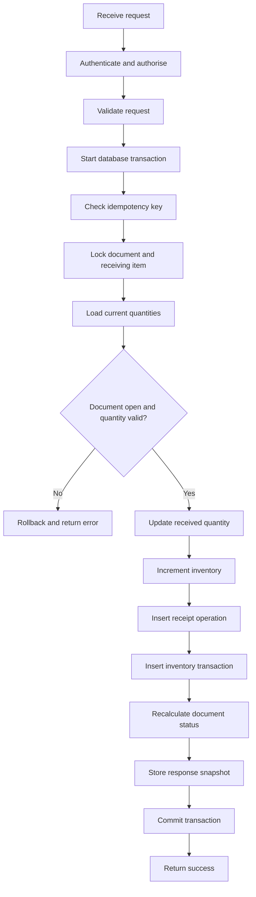

# Technical Specification

## Warehouse Receiving System

**Document Version:** 1.0  
**Status:** Initial Draft  
**Backend:** Node.js, Express, TypeScript  
**Frontend:** React, TypeScript, Vite  
**Database:** PostgreSQL  
**ORM:** Prisma ORM

---

## 1. Technical Overview

### 1.1 Objective

This document defines the technical design for implementing the Warehouse Receiving System described in `/docs/prd.md`.

The application manages products, receiving documents, received quantities, available inventory, and inventory transaction history. The backend is responsible for enforcing all business rules and maintaining data consistency.

### 1.2 Technology Stack

| Component | Technology | Responsibility |
|---|---|---|
| Frontend | React, TypeScript, Vite | User interface and API integration |
| Backend | Node.js, Express, TypeScript | REST API and business logic |
| Database | PostgreSQL | Persistent relational data |
| ORM | Prisma ORM | Database access and schema migrations |
| Validation | Zod | Request validation |
| Authentication | JWT | Authenticated API access |
| API documentation | OpenAPI, Swagger UI | API contract and interactive documentation |
| Testing | Vitest, Supertest | Unit and API integration tests |
| Deployment | Docker, Docker Compose | Reproducible application environment |
| Diagrams | Mermaid | ERD and data-flow documentation |

### 1.3 Architectural Principles

1. Business rules must be enforced by the backend.
2. The frontend must not directly access the database.
3. All receipt-related database changes must be atomic.
4. Inventory transactions must provide an auditable record of stock movements.
5. Database constraints must protect critical uniqueness and referential integrity requirements.
6. The application must be testable and runnable using the documented setup instructions.

---

## 2. System Architecture

The system uses a three-layer architecture.



### 2.1 Frontend

The frontend provides the user interface for:

- Login.
- Product listing and creation.
- Receiving document listing and creation.
- Receiving document details.
- Partial and full receipt recording.
- Inventory listing.
- Inventory transaction history.

The frontend validates user input for usability, but it must not be treated as the authority for business-rule enforcement.

### 2.2 Backend

The backend is responsible for:

- Authentication and authorisation.
- Request validation.
- Product and receiving document management.
- Receipt processing.
- Inventory updates.
- Document status calculation.
- Inventory transaction recording.
- Idempotency and duplicate request handling.
- Consistent API error responses.

### 2.3 Database

PostgreSQL stores the application's persistent data. Prisma provides typed database access and migration management.

Critical receipt operations use database transactions and appropriate locking to prevent concurrent requests from exceeding the expected quantity.

---

## 3. Project Structure

Recommended repository structure:

```text
warehouse-receiving-system/
├── apps/
│   ├── api/
│   │   ├── prisma/
│   │   │   ├── schema.prisma
│   │   │   ├── migrations/
│   │   │   └── seed.ts
│   │   ├── src/
│   │   │   ├── config/
│   │   │   ├── middleware/
│   │   │   ├── modules/
│   │   │   │   ├── auth/
│   │   │   │   ├── products/
│   │   │   │   ├── receiving/
│   │   │   │   ├── inventory/
│   │   │   │   └── transactions/
│   │   │   ├── lib/
│   │   │   ├── app.ts
│   │   │   └── server.ts
│   │   ├── tests/
│   │   ├── package.json
│   │   └── tsconfig.json
│   └── web/
│       ├── src/
│       │   ├── components/
│       │   ├── pages/
│       │   ├── services/
│       │   ├── hooks/
│       │   └── types/
│       ├── package.json
│       └── tsconfig.json
├── docs/
│   ├── prd.md
│   ├── technical-spec.md
│   ├── erd.mmd
│   ├── openapi.yaml
│   ├── data-flow.mmd
│   ├── ai-workflow.md
│   └── testing.md
├── docker-compose.yml
├── .env.example
├── .gitignore
└── README.md
```

### Module responsibilities

| Module | Responsibility |
|---|---|
| `auth` | Login, JWT generation, authentication |
| `products` | Product listing and creation |
| `receiving` | Receiving document management and receipt processing |
| `inventory` | Available stock queries |
| `transactions` | Inventory transaction history |
| `middleware` | Authentication, authorisation, error handling |
| `config` | Environment configuration |
| `lib` | Shared utilities and database client |

The structure separates business responsibilities without introducing unnecessary microservices.

---

## 4. Database Design

### 4.1 Entity Relationship Diagram

The following diagram describes the proposed relational data model.



The diagram represents the proposed model. Database constraints and the Prisma schema must reflect the same relationships.

### 4.2 Table Definitions

#### `users`

| Field | Type | Constraint |
|---|---|---|
| `id` | UUID | Primary key |
| `email` | VARCHAR(255) | Required, unique |
| `password_hash` | VARCHAR(255) | Required |
| `role` | ENUM | `OPERATOR` or `SUPERVISOR` |
| `created_at` | TIMESTAMPTZ | Required |

The initial users should be created using a seed script. Passwords must be hashed before storage.

#### `products`

| Field | Type | Constraint |
|---|---|---|
| `id` | UUID | Primary key |
| `sku` | VARCHAR(100) | Required, unique |
| `name` | VARCHAR(255) | Required |
| `created_at` | TIMESTAMPTZ | Required |
| `updated_at` | TIMESTAMPTZ | Required |

SKU values should be normalised consistently, for example by trimming whitespace and converting to uppercase before insertion. A database-level uniqueness constraint must remain in place so concurrent requests cannot create duplicate SKUs.

#### `receiving_documents`

| Field | Type | Constraint |
|---|---|---|
| `id` | UUID | Primary key |
| `document_number` | VARCHAR(50) | Required, unique |
| `status` | ENUM | `PENDING`, `PARTIALLY_RECEIVED`, `COMPLETED` |
| `created_by` | UUID | Foreign key to `users.id` |
| `created_at` | TIMESTAMPTZ | Required |
| `updated_at` | TIMESTAMPTZ | Required |

Document numbers must be generated by the backend, not trusted from arbitrary frontend input. A unique database constraint must prevent collisions.

#### `receiving_items`

| Field | Type | Constraint |
|---|---|---|
| `id` | UUID | Primary key |
| `document_id` | UUID | Foreign key |
| `product_id` | UUID | Foreign key |
| `expected_quantity` | INTEGER | Greater than zero |
| `received_quantity` | INTEGER | At least zero |
| `created_at` | TIMESTAMPTZ | Required |
| `updated_at` | TIMESTAMPTZ | Required |

Required constraints:

- `expected_quantity > 0`.
- `received_quantity >= 0`.
- `received_quantity <= expected_quantity`.
- Unique combination of `(document_id, product_id)`.

These constraints supplement service-level validation.

#### `inventories`

| Field | Type | Constraint |
|---|---|---|
| `id` | UUID | Primary key |
| `product_id` | UUID | Foreign key, unique |
| `available_quantity` | INTEGER | Required, at least zero |
| `updated_at` | TIMESTAMPTZ | Required |

Each product has at most one inventory record in the single-warehouse version. An inventory record should be created when the product is created, with `available_quantity = 0`.

#### `receipt_operations`

| Field | Type | Constraint |
|---|---|---|
| `id` | UUID | Primary key |
| `idempotency_key` | VARCHAR(255) | Required, unique |
| `request_hash` | VARCHAR(64) | Required |
| `receiving_item_id` | UUID | Foreign key |
| `performed_by` | UUID | Foreign key to `users.id` |
| `quantity` | INTEGER | Greater than zero |
| `response_snapshot` | JSONB | Required |
| `created_at` | TIMESTAMPTZ | Required |

This table records accepted receipt requests and supports safe retries. The request hash is calculated from the relevant request data. Reusing an idempotency key with a different payload must be rejected.

The response snapshot preserves the original result for a retry, rather than treating the same request as a new receipt.

#### `inventory_transactions`

| Field | Type | Constraint |
|---|---|---|
| `id` | UUID | Primary key |
| `product_id` | UUID | Foreign key |
| `receiving_item_id` | UUID | Foreign key |
| `receipt_operation_id` | UUID | Foreign key, unique |
| `transaction_type` | ENUM or VARCHAR | `RECEIPT` |
| `quantity_change` | INTEGER | Greater than zero for receipts |
| `performed_by` | UUID | Foreign key to `users.id` |
| `created_at` | TIMESTAMPTZ | Required |

Each accepted receipt operation creates exactly one corresponding inventory transaction. Transaction records must not be edited or deleted through ordinary application functions.

### 4.3 Indexes

Recommended indexes:

- Unique index on `users.email`.
- Unique index on `products.sku`.
- Unique index on `receiving_documents.document_number`.
- Index on `receiving_documents.status`.
- Index on `receiving_documents.created_at`.
- Unique composite index on `receiving_items(document_id, product_id)`.
- Index on `receiving_items.product_id`.
- Unique index on `inventories.product_id`.
- Unique index on `receipt_operations.idempotency_key`.
- Index on `inventory_transactions.product_id, created_at`.
- Index on `inventory_transactions.receiving_item_id`.

Foreign keys must use appropriate delete restrictions to preserve historical records. Product and receiving records referenced by inventory history should not be physically deleted.

### 4.4 Inventory as a Source of Truth

`inventories.available_quantity` is the current stock value used by the inventory listing.

`inventory_transactions` is the historical audit trail for stock movements. The system must update both within the same database transaction.

A useful consistency check is:

`Current stock = Opening stock + Sum of inventory transaction quantity changes`

In the initial release, opening stock is zero because opening stock adjustments are out of scope. If opening balances are introduced later, they must be represented explicitly rather than silently changing the inventory value.

---

## 5. API Design

### 5.1 API Conventions

- Base path: `/api/v1`.
- Data format: JSON.
- Authentication: Bearer JWT.
- Content type: `application/json`.
- UUIDs identify persistent resources.
- Dates use ISO 8601 timestamps.
- Pagination is recommended for list endpoints.
- Validation and business rules are enforced by the backend.

### 5.2 Endpoint List

| Method | Endpoint | Purpose |
|---|---|---|
| `POST` | `/api/v1/auth/login` | Authenticate a user |
| `GET` | `/api/v1/auth/me` | Retrieve the current user |
| `GET` | `/api/v1/products` | List products |
| `POST` | `/api/v1/products` | Create a product |
| `GET` | `/api/v1/receiving-documents` | List receiving documents |
| `POST` | `/api/v1/receiving-documents` | Create a receiving document |
| `GET` | `/api/v1/receiving-documents/:id` | Retrieve document details |
| `POST` | `/api/v1/receiving-documents/:id/items/:itemId/receipts` | Record a receipt |
| `GET` | `/api/v1/inventory` | List available inventory |
| `GET` | `/api/v1/inventory/transactions` | List inventory transaction history |
| `GET` | `/health` | Check application health |
| `GET` | `/ready` | Check application readiness |

Product creation is restricted to supervisors. Other permissions follow the role policy in the PRD.

### 5.3 Login

**Request**

`POST /api/v1/auth/login`

```json
{
  "email": "operator@example.com",
  "password": "example-password"
}
```

**Successful response: `200 OK`**

```json
{
  "data": {
    "accessToken": "<jwt-token>",
    "user": {
      "id": "uuid",
      "email": "operator@example.com",
      "role": "OPERATOR"
    }
  }
}
```

Invalid credentials return `401 Unauthorized`. Production deployments must use HTTPS and an appropriate token lifetime.

### 5.4 Create Product

**Request**

`POST /api/v1/products`

```json
{
  "sku": "SKU-001",
  "name": "Sample Product"
}
```

**Successful response: `201 Created`**

```json
{
  "data": {
    "id": "uuid",
    "sku": "SKU-001",
    "name": "Sample Product",
    "availableQuantity": 0
  }
}
```

Validation:

- SKU and name are required.
- Empty values are rejected.
- SKU is normalised before persistence.
- Duplicate SKU returns `409 Conflict`.
- Only a supervisor may create a product.

### 5.5 Create Receiving Document

**Request**

`POST /api/v1/receiving-documents`

```json
{
  "items": [
    {
      "productId": "product-uuid-1",
      "expectedQuantity": 100
    },
    {
      "productId": "product-uuid-2",
      "expectedQuantity": 50
    }
  ]
}
```

**Successful response: `201 Created`**

```json
{
  "data": {
    "id": "document-uuid",
    "documentNumber": "RCV-20261028-0001",
    "status": "PENDING",
    "items": [
      {
        "id": "item-uuid-1",
        "productId": "product-uuid-1",
        "expectedQuantity": 100,
        "receivedQuantity": 0,
        "remainingQuantity": 100
      }
    ]
  }
}
```

The document number shown is an example format, not a prescribed sequence. The implementation must generate a unique value safely.

Validation:

- The items array must contain at least one item.
- Product IDs must exist.
- Duplicate product IDs within the same document are rejected.
- Expected quantities must be positive integers.
- Initial received quantities and status are assigned by the backend.
- Document creation and item creation must be atomic.

### 5.6 Record a Receipt

**Request**

`POST /api/v1/receiving-documents/:id/items/:itemId/receipts`

Header:

`Idempotency-Key: <unique-client-generated-key>`

Body:

```json
{
  "quantity": 60
}
```

**Successful response: `201 Created`**

```json
{
  "data": {
    "receiptOperationId": "receipt-uuid",
    "documentNumber": "RCV-20261028-0001",
    "itemId": "item-uuid-1",
    "quantityReceivedNow": 60,
    "cumulativeReceivedQuantity": 60,
    "remainingQuantity": 40,
    "availableStock": 60,
    "documentStatus": "PARTIALLY_RECEIVED"
  }
}
```

The values above illustrate the response for a new product with zero initial stock and an expected quantity of 100.

Validation and processing:

1. The caller must be authenticated and authorised.
2. The idempotency key must be present and valid.
3. The receipt quantity must be a positive integer.
4. The document and item must exist and belong together.
5. The document must not be completed.
6. The quantity must not exceed the current remaining quantity.
7. The backend updates the received quantity and inventory.
8. The backend creates the receipt operation and inventory transaction.
9. The backend recalculates the document status.
10. All changes commit together.

A request that exceeds the remaining quantity returns `422 Unprocessable Entity`. A receipt against a completed document is rejected with a documented business-rule error.

A repeated request with the same key and identical payload returns the stored original result without increasing stock again. Reusing that key with a different payload returns `409 Conflict`.

### 5.7 Inventory Listing

**Request**

`GET /api/v1/inventory?page=1&limit=20&search=SKU-001`

**Example response**

```json
{
  "data": [
    {
      "productId": "product-uuid-1",
      "sku": "SKU-001",
      "name": "Sample Product",
      "availableQuantity": 60
    }
  ],
  "meta": {
    "page": 1,
    "limit": 20,
    "total": 1
  }
}
```

The endpoint must return persisted stock values and should support pagination and product search.

### 5.8 Inventory Transaction History

**Request**

`GET /api/v1/inventory/transactions?page=1&limit=20&productId=product-uuid-1`

**Example response**

```json
{
  "data": [
    {
      "id": "transaction-uuid",
      "productId": "product-uuid-1",
      "sku": "SKU-001",
      "transactionType": "RECEIPT",
      "quantityChange": 60,
      "documentNumber": "RCV-20261028-0001",
      "performedBy": "operator@example.com",
      "createdAt": "2026-10-28T10:00:00.000Z"
    }
  ],
  "meta": {
    "page": 1,
    "limit": 20,
    "total": 1
  }
}
```

Transactions should be ordered by creation time, newest first. The endpoint must not expose password hashes or other sensitive user data.

### 5.9 Standard Error Format

Use a consistent error response:

```json
{
  "error": {
    "code": "RECEIPT_EXCEEDS_REMAINING",
    "message": "The receipt quantity exceeds the remaining expected quantity.",
    "details": {
      "remainingQuantity": 40
    }
  }
}
```

Recommended HTTP status codes:

| Status | Meaning |
|---|---|
| `400` | Malformed request or invalid request structure |
| `401` | Missing or invalid authentication |
| `403` | Authenticated but not authorised |
| `404` | Resource not found |
| `409` | Duplicate resource or idempotency conflict |
| `422` | Valid request structure but invalid business operation |
| `429` | Rate limit exceeded, if rate limiting is implemented |
| `500` | Unexpected server error |

The API must not expose database credentials, stack traces, or internal SQL details in production error responses.

---

## 6. Receipt Processing and State Transitions

### 6.1 Document Status Calculation

The backend calculates document status from the persisted quantities of all its items.

- `PENDING`: Every item's received quantity is zero.
- `COMPLETED`: Every item's received quantity equals its expected quantity.
- `PARTIALLY_RECEIVED`: At least one unit has been received, but not all items are complete.

The backend must not accept a status value from the receipt request.

### 6.2 Status Transition Diagram



The diagram describes status changes resulting from valid receipt operations. There are no transitions out of `COMPLETED` in the initial scope.

### 6.3 Receipt Transaction Flow



### 6.4 Atomicity and Concurrency

A receipt operation must update the following records in one PostgreSQL transaction:

1. The receiving item's cumulative received quantity.
2. The product's available inventory.
3. The receipt operation used for idempotency.
4. The inventory transaction.
5. The receiving document's status.
6. The stored response snapshot.

If any required step fails, all changes must roll back.

The implementation should lock the receiving document and relevant receiving item before validating the remaining quantity. A consistent lock order must be used across receipt operations to reduce deadlock risk.

The remaining quantity is calculated from the locked, current database values:

`Remaining quantity = Expected quantity - Cumulative received quantity`

The backend must validate the new cumulative quantity before writing updates.

**Important:** A preliminary read followed by an unlocked update is insufficient. Two concurrent requests could otherwise both pass validation using the same stale remaining quantity.

---

## 7. Authentication and Authorisation

### 7.1 Authentication

The login endpoint verifies the supplied credentials against a securely hashed password. Successful login returns a signed JWT.

The authentication middleware validates the token and attaches the authenticated user's ID and role to the request context.

### 7.2 Authorisation Matrix

| Operation | Operator | Supervisor |
|---|---|---|
| Login and view own identity | Yes | Yes |
| List products | Yes | Yes |
| Create products | No | Yes |
| List receiving documents | Yes | Yes |
| Create receiving documents | Yes | Yes |
| View receiving document details | Yes | Yes |
| Record receipts | Yes | Yes |
| View inventory | Yes | Yes |
| View inventory transaction history | Yes | Yes |

This matrix follows the initial PRD assumptions. It can be revised if the hiring team specifies different role permissions.

### 7.3 Security Requirements

- Hash passwords using a suitable password-hashing algorithm, such as Argon2id or bcrypt with an appropriate work factor.
- Keep JWT secrets in environment variables.
- Never commit real credentials or secrets.
- Validate all input on the backend.
- Use parameterised database operations through Prisma or safe parameterised raw queries.
- Enforce authorisation on every protected endpoint.
- Avoid logging passwords, access tokens, or other secrets.

---

## 8. Testing Strategy

Testing must focus on business-rule correctness rather than only checking whether endpoints return successful responses.

### 8.1 Unit Tests

Unit tests should cover:

- Remaining quantity calculation.
- Document status calculation.
- Receipt quantity validation.
- SKU normalisation.
- Request payload validation.
- Role permission decisions.

### 8.2 Integration Tests

Integration tests should use a test database and verify actual persistence.

| ID | Scenario | Expected result |
|---|---|---|
| T-01 | Create a valid product | Product exists; stock is zero |
| T-02 | Create a duplicate SKU | Request rejected; no duplicate product |
| T-03 | Create a document with no items | Request rejected |
| T-04 | Create a document with duplicate product items | Request rejected |
| T-05 | Create a document with a negative expected quantity | Request rejected |
| T-06 | Receive a valid partial quantity | Received quantity and stock increase correctly |
| T-07 | Receive the exact remaining quantity | Item completes; document completes if all items are complete |
| T-08 | Receive more than the remaining quantity | Request rejected; no data changes |
| T-09 | Receive zero or a negative quantity | Request rejected |
| T-10 | Receive against a completed document | Request rejected |
| T-11 | Retry a request with the same key and payload | No additional stock movement |
| T-12 | Reuse a key with a different payload | Conflict returned; no additional movement |
| T-13 | Submit concurrent receipts that together exceed the remaining quantity | At most the valid quantity is accepted |
| T-14 | Simulate a failure during receipt processing | All related changes roll back |
| T-15 | Access a protected endpoint without a token | `401 Unauthorized` |
| T-16 | Operator attempts to create a product | `403 Forbidden` |
| T-17 | View transaction history after a receipt | Correct transaction and document reference returned |
| T-18 | Check inventory after multiple receipts | Stock equals the sum of accepted receipt quantities |

### 8.3 Test Data Isolation

Each integration test must use isolated test data or reset the test database safely between runs.

Tests must not connect to a production database. Test database configuration must be explicit.

### 8.4 Evidence to Record

The testing documentation should include:

- Test command and execution date.
- Automated test results.
- Example successful partial receipt.
- Example successful completion.
- Evidence that invalid receipts leave stock unchanged.
- Evidence that repeated requests do not duplicate stock.
- Evidence that concurrent requests preserve quantity limits.
- Known limitations or failed tests.

Screenshots or terminal output should show actual execution results, not fabricated examples.

---

## 9. Deployment Design

### 9.1 Docker Services

Docker Compose should define at least:

- `db`: PostgreSQL.
- `api`: Node.js Express application.
- `web`: React application served by a production web server.

The API must connect to PostgreSQL using environment-based configuration.

### 9.2 Environment Configuration

The `.env.example` file should document the required variables without containing real secrets.

Example:

```dotenv
NODE_ENV=development
PORT=3000
DATABASE_URL=postgresql://app:app_password@db:5432/warehouse
JWT_SECRET=replace-with-a-long-random-secret
JWT_EXPIRES_IN=15m
CORS_ORIGIN=http://localhost:5173
```

These values are illustrative development settings only. Production secrets must be generated and managed separately.

The frontend API base URL should also be configurable for the deployment environment.

### 9.3 Database Migrations

The application must use version-controlled Prisma migrations.

Recommended clean-start sequence:

1. Start PostgreSQL.
2. Wait for database health checks to pass.
3. Apply committed database migrations.
4. Run the user seed process when needed.
5. Start the API.
6. Start or serve the frontend.

Production startup should apply committed migrations through a controlled deployment step, rather than relying on `prisma db push` to alter the schema implicitly.

### 9.4 Health and Readiness

`GET /health` confirms that the API process is running.

`GET /ready` confirms that the application can reach the database and is ready to serve requests.

Docker Compose should use a PostgreSQL health check and appropriate service dependencies. A healthy database alone does not prove that the API is ready.

### 9.5 Startup Instructions

The README should document:

1. Required software and versions.
2. How to clone the repository.
3. How to configure environment variables.
4. How to build and start the services with Docker Compose.
5. How database migrations and initial user creation work.
6. Local frontend and API URLs.
7. Swagger UI URL.
8. Test commands.
9. How to stop the services.
10. Troubleshooting steps for common startup errors.

The final startup procedure must be tested from a clean environment.

---

## 10. Implementation Sequence

The development order should minimise rework and prioritise the core business flow.

### Phase 1: Foundation

- Create the Git repository and project structure.
- Configure Express, TypeScript, PostgreSQL, and Prisma.
- Configure Docker Compose and environment variables.
- Add the initial database migration.

### Phase 2: Backend Core

- Implement authentication and role-based access.
- Implement product creation and listing.
- Implement receiving document creation and detail retrieval.
- Implement receipt processing with transactions and idempotency.
- Implement inventory and transaction history endpoints.

### Phase 3: Testing

- Add unit tests for business rules.
- Add integration tests for receipt processing.
- Verify duplicate requests and concurrency handling.
- Confirm failed operations do not change stock.

### Phase 4: Frontend

- Implement login.
- Implement product listing and creation.
- Implement receiving document listing, creation, and details.
- Implement partial receipt forms.
- Implement inventory and transaction history pages.
- Display validation and API errors clearly.

### Phase 5: Documentation and Delivery

- Complete the OpenAPI specification.
- Create the ERD and data-flow diagrams.
- Document the AI-assisted development workflow.
- Record real test evidence.
- Test Docker startup from a clean environment.
- Review Git history and ensure no secrets are committed.

---

## 11. Technical Decisions and Known Limitations

| Topic | Initial decision | Reason or limitation |
|---|---|---|
| Backend framework | Express with TypeScript | Small REST API with straightforward routing |
| Database | PostgreSQL | Relational constraints and transaction support |
| ORM | Prisma | Typed database access and migrations |
| Stock storage | Persisted inventory per product | Efficient inventory queries |
| Stock audit | Immutable inventory transactions | Traceability of accepted stock movements |
| Receipt retry | Idempotency key plus unique database constraint | Prevent duplicate processing |
| Concurrent receipt | Database transaction and row locking | Preserve expected quantity limits |
| Warehouse model | Single warehouse | Multi-warehouse support is out of scope |
| Initial stock | Zero | Opening stock adjustments are not in scope |
| Receiving cancellation | Not supported | Requires a separate reversal design |
| Performance target | Not specified | Must not be treated as an agreed requirement |

### Final Design Rule

The backend must be the authority for receipt validation, inventory updates, and receiving status. The frontend may improve usability, but it must never be able to bypass those rules by submitting arbitrary quantities or document statuses.

This technical specification should be kept consistent with `/docs/prd.md`, `/docs/erd.mmd`, `/docs/openapi.yaml`, `/docs/data-flow.mmd`, and `/docs/testing.md`. Any changes to the business requirements must be reflected in both the documentation and the implementation.
